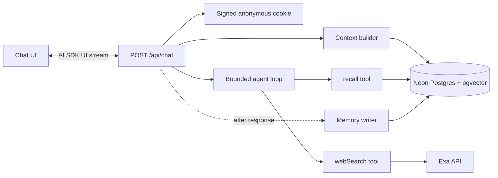
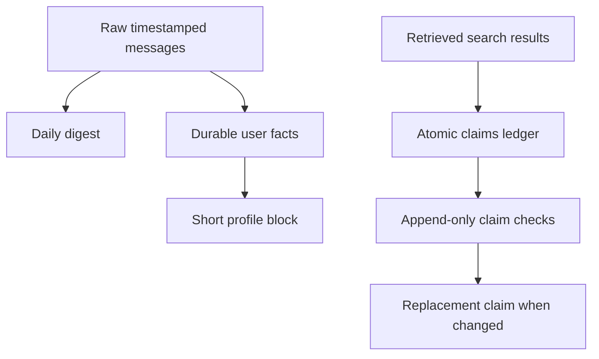

# Architecture

This application is a two-tool research chat agent: it can search the web and
recall first-party conversation memory. The model never receives authority to
choose a user id or write memory directly.

## Request lifecycle

1. The route resolves the server-side identity, validates the request, and
   authorizes or creates the conversation.
2. The user message is persisted before model execution. History is reloaded
   from Postgres, so clients cannot inject prior assistant or tool messages.
3. The context builder loads the profile, relevant facts, local time, and recent
   conversation history. Memory retrieval degrades safely if embeddings fail.
4. The agent runs a capped tool loop. Per-request closures bind `userId`, source
   ids, retrieved results, and tool telemetry; neither tool accepts a user id.
5. Tool parts and answer text stream to the UI. The completed assistant message
   stores both plain text and full AI SDK parts.
6. Next.js `after()` invokes an idempotent writer. It extracts durable facts only
   from user-authored text, records web claims with provenance, audits recalled
   claims when fresh search ran, and refreshes the daily digest and profile.

## Memory and provenance

- Raw messages remain the source of truth for date-based questions.
- Active facts and the profile are injected on every turn; `recall` handles
  deeper, cross-conversation, and date-constrained lookup.
- Claims retain their queries, retrieved sources, valid time, transaction time,
  status, and supersession chain. Reverification appends a check instead of
  overwriting history.
- Facts, claims, messages, and digests support keyword retrieval. Facts, claims,
  and digests also use 1536-dimension embeddings and cosine HNSW indexes.

## Trust boundaries

- All request, environment, tool, and structured-model boundaries use Zod.
- Every database query is scoped with the cookie-derived `user_id`.
- Web content is untrusted data and is never provided to the user-fact extractor.
- Answer citations are checked against the per-turn source registry.
- Search, embedding, and writer failures are observable and have explicit
  degraded behavior.

`lib/agent/**` and `lib/memory/**` remain framework-free. Next.js route handlers
own cookies, streaming response adaptation, and `after()` scheduling.
